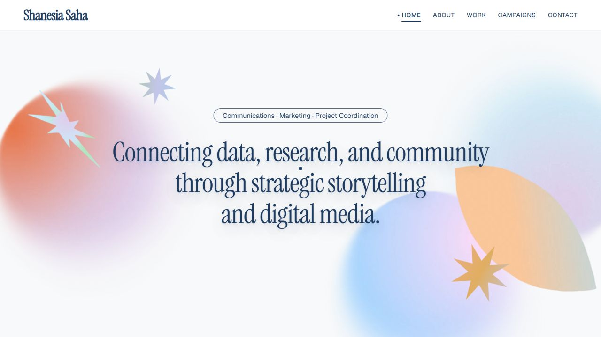
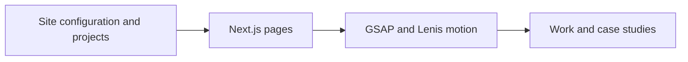

<div align="center">

# 🎨 Sia — Design Portfolio

**An editorial portfolio for communications, marketing, and creative work.**

[](https://nextjs.org/)
[](https://react.dev/)
[](https://www.typescriptlang.org/)
[](https://tailwindcss.com/)
[](https://gsap.com/)
[](https://lenis.darkroom.engineering/)
[](https://vercel.com/)

**[Open live project](https://shanesia-portfolio.vercel.app/)**



<sub>Current live homepage after the intro animation and artwork finished loading.</sub>

</div>

---

## 📋 Contents

- [Overview](#-overview)
- [Key Capabilities](#-key-capabilities)
- [Architecture](#-architecture)
- [Tech Stack](#-tech-stack)
- [Getting Started](#-getting-started)
- [Verification](#-verification)
- [Repository Layout](#-repository-layout)
- [Configuration & Customization](#-configuration--customization)
- [Architecture & Engineering Notes](#-architecture--engineering-notes)

---

## 💡 Overview

An award-style creative portfolio built with Next.js 15 App Router, React 19, GSAP ScrollTrigger, and Lenis smooth scrolling. Features editorial serif typography, a scroll-driven trigonometric orbit hero, organic conic-gradient process disks, and seamless reduced-motion accessibility.

---

## ✨ Key Capabilities

- **Scroll-Driven Motion & Animations**: Orchestrated using GSAP 3 and ScrollTrigger, featuring a trigonometric hero orbit convergence (`orbitEngine.ts`), conic-gradient process disks (`processStack.ts`), and Lenis smooth scrolling.
- **Interactive Work & Case Studies**: Dynamic project showcases at `/work` with slider navigation and deep-dive case study layouts at `/work/[slug]`, driven centrally from `projects.ts`.
- **Curtain & Page Transitions**: Frictionless route navigation powered by curtain overlay transitions (`PageTransitionProvider.tsx`) and an interactive custom mouse cursor (`CursorDot.tsx`).
- **Centralized Site Configuration**: Single-file management for identity, social profiles, awards, dynamic tool marquees, and testimonials inside `siteConfig.ts`.
- **Automatic Reduced Motion**: Native `prefers-reduced-motion` compliance that gracefully disables intense orbit physics, video autoplay, and explosion effects.
- **Modern Typographic Hierarchy**: Editorial serif displays (Instrument Serif), modern body type (Geist), and clean metadata monospace (Roboto Mono) configured via `next/font`.

---

## 🏗️ Architecture



---

## 🧱 Tech Stack

| Layer | Technology |
|---|---|
| Framework | next ^15.1.0 |
| UI | react ^19.0.0 |
| Motion | gsap ^3.15.0 |

---

## 🚀 Getting Started

### Prerequisites

- **Node.js**: `v18.17.0+`
- **Package Manager**: `npm`, `pnpm`, or `yarn`

---

### Local Development Setup

1. **Clone the repository**:
   ```bash
   git clone https://github.com/ZenzerJs/Sia-Portfolio.git
   cd Sia-Portfolio
   ```

2. **Install dependencies**:
   ```bash
   npm install
   ```

3. **Run the local development server**:
   ```bash
   npm run dev
   ```

4. **View in browser**:
   Navigate to [http://localhost:3000](http://localhost:3000).

---

## 🧪 Verification

| Command | Action |
| :--- | :--- |
| `npm run dev` | Starts local Next.js development server at port 3000 |
| `npm run build` | Compiles optimized production bundle |
| `npm run start` | Boots production build locally |
| `npm run lint` | Runs ESLint analysis across TypeScript and React codebases |

---

## 📁 Repository Layout

```text
sia-portfolio/
├── public/
│   └── assets/                 # SVGs, WebP shapes, tool icons, & resume.pdf
├── src/
│   ├── app/                    # Next.js 15 App Router pages & metadata
│   │   ├── about/              # About page route
│   │   ├── work/               # Work portfolio & dynamic [slug] case studies
│   │   ├── globals.css         # Design tokens, CSS variables, & pin-spacer rules
│   │   ├── layout.tsx          # Font setups & dynamic Open Graph metadata
│   │   └── page.tsx            # Main landing page
│   ├── components/             # Modular UI & animation components
│   │   ├── CursorDot.tsx       # Custom mouse follower
│   │   ├── PortfolioHome.tsx   # Core homepage layout container
│   │   ├── PageTransitionProvider.tsx # Page-to-page curtain overlays
│   │   ├── SiteHeader.tsx      # Persistent site navigation
│   │   └── ToolMarquee.tsx     # Infinite scroll tool & software strip
│   └── lib/                    # Animation engines & structured content data
│       ├── heroExplode.ts      # Intro loader & curtain timing engine
│       ├── orbitEngine.ts      # Trigonometric scroll convergence math
│       ├── processStack.ts     # Conic-gradient process disk logic
│       ├── projects.ts         # Portfolio case study registry
│       ├── siteConfig.ts       # Global profile, links, & testimonial data
│       └── testimonialRotator.ts # Drag/swipe quote slider engine
├── design-system.json          # Core palette & color token specifications
├── tailwind.config.ts          # Custom Tailwind canvas, surface, & font configs
└── vercel.json                 # Vercel production hosting configuration
```

---

## ⚙️ Configuration & Customization

### 1. Global Identity & Socials (`lib/siteConfig.ts`)
Update all personal information, links, and content blocks from a single file:
- **Profile Info**: `name`, `role`, `tagline`, `person`, and `location`.
- **Navigation & Socials**: LinkedIn, Instagram, Behance, and direct contact email.
- **Awards & Marquee**: List recognition entries, awards, and icon SVGs for the scrolling tool ribbon.
- **SEO & Domain**: Update `siteConfig.domain` / `metadataBase` to match your live deployment URL.

### 2. Projects & Case Studies (`lib/projects.ts`)
Add or edit project entries to automatically generate both the `/work` showcase slider and `/work/[slug]` dynamic case study pages:

```ts
{
  slug: "custom-ai-pipeline",
  name: "OmniArchitect",
  tagline: "Multi-Agent AI Orchestrator",
  categories: ["Machine Learning", "System Design"],
  description: "Autonomous stateful multi-agent system built on LangGraph.",
  role: "Lead Architecture & Engineering",
  timeline: "8 weeks",
  tools: "Python, FastAPI, Next.js, LangGraph",
  accent: "#C1E4F7",
  phases: [...]
}
```

### 3. Static Assets & Media (`public/assets/`)
Replace placeholder assets with your custom branding while keeping file names consistent:
- `logo.svg`: Preloader and header brand icon.
- `shape-*.webp`: Hero orbit geometry and textural shapes.
- `laptop-sequence-_00073.webp`: Device frame wrapping the work showreel.
- `resume.pdf`: Downloadable CV linked across the About section.

---

## 📐 Architecture & Engineering Notes

- **StrictMode-Safe GSAP Cleanups**: All GSAP animation engines in `lib/` are mounted inside `useEffect` lifecycles with full context cleanup to avoid duplicate triggers.
- **Absolute Pin-Spacer Rule**: The hero section pins its backdrop using ScrollTrigger. Keep `.hero .pin-spacer { position: absolute !important; }` in `app/globals.css` to prevent content below the fold from being displaced.
- **Reduced Motion Support**: Animations automatically detect system accessibility settings via `prefers-reduced-motion` and collapse complex physics into instant, clean transitions.

<div align="center">

*Designed and developed for Shanesia Saha by [@ZenzerJs](https://github.com/ZenzerJs).*

</div>
